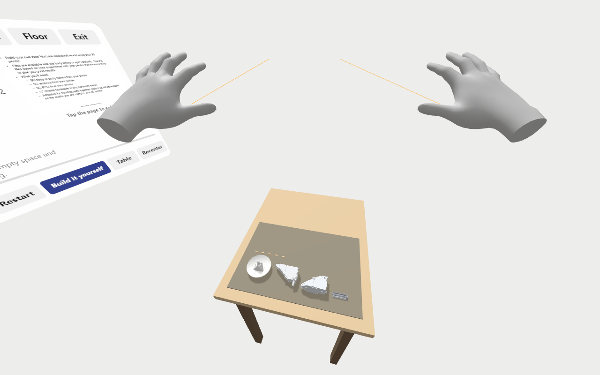
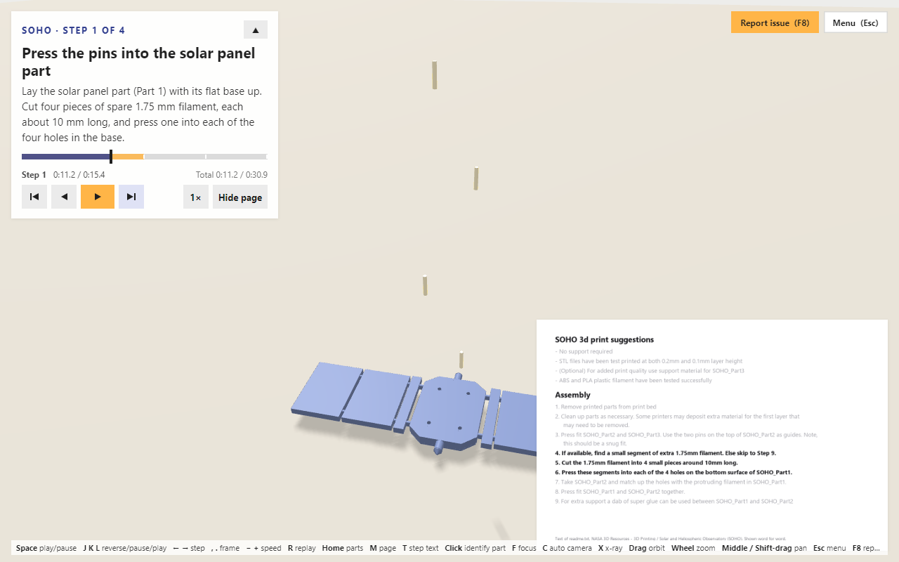

# Open Assembly Lab

**Public-domain kits as 3D assembly instructions you can build with your hands in VR - in the browser, nothing to install.**

**Live: https://hybrisen777.github.io/open-assembly-lab/**

Printed instructions show a few frozen moments; this shows the whole motion. Every step is animated from the loose
parts to the finished model, next to the original instruction page - and in VR you do the steps yourself, with your
hands, on a table in front of you.

Everything shown here comes from sources that are free to reuse: the two kits are NASA's 3D-printable models of the
New Horizons and SOHO spacecraft, each with its own assembly instructions from the same source.

## Try it

| Device | How |
|---|---|
| **Meta Quest** | Open the link in the **Quest Browser**, pick the kit, press **Enter VR**. Hands or controllers. |
| **Android phone** | Chrome, **Enter AR**: the kit stands on your real table or floor. |
| **Desktop / laptop / iPhone** | Any current browser: 3D player with mouse, touch and keyboard. |

## In VR - built for hands

- **Hands first.** Point and pinch to press buttons; pinch a glowing part, bring it to its blue outline - it clicks in
  by itself. No controller needed from start to finish (controllers work too).
- **Seated or standing, no walking.** The kit comes to a table in front of you, every part within reach. Pinch with
  both hands in empty space and pull apart to make it bigger, move or turn it.
- **Forgiving like real assembly.** Identical parts are interchangeable (any dowel in any hole).
- **Watch or build.** *Just watch* plays the animation; *Build it yourself* waits for you at every move.
- **The instructions stay with you.** The original page is on the panel; tap it for a large, sharp copy.

## What's inside

**New Horizons spacecraft model** - 4 steps, 9 parts: the body printed in two halves, the RTG and the antenna (NASA's
STL files, unchanged), joined with five 1/4 x 1/2 inch dowels from a hardware store. The finished model is about
17 x 14 x 11 cm; the player shows it at real size.

**SOHO spacecraft model** - 4 steps, 7 parts: the solar panel part with the antenna dish, the lower body and the
upper body (the kit's three STL files, unchanged), joined with four 10 mm pins cut from spare 1.75 mm printer filament.
The finished model is about 17.5 cm across the solar panels and 6.6 cm tall. Its instructions are a plain text file;
the page beside each step shows that text word for word, with the lines of the current step in black. The text
presses the two body parts together first; here that step comes last, so that every part is added from above.

More public-domain kits can be added the same way: part meshes + step-by-step instructions in, a scenario out.

## How it's made

- **Parts** are the kit's own meshes, one object per physical part. Their assembled positions are worked out from the
  pins and holes in the meshes.
- **Assembly motion** is planned and collision-checked in Unity (mesh against mesh along every part's path), then
  exported as engine-independent data - step timelines and poses - that this site plays with
  [three.js](https://threejs.org) 0.169. A static site: no framework, no build step in the browser.
- **VR / AR** is plain [WebXR](https://immersiveweb.dev): hand tracking, world-space panels, grab-and-snap logic.
- **Checks**: `tools/smoke_test.js` plays every kit to the end with the mouse, then starts a hands-only VR session on
  an emulated headset and places every part of every kit with emulated tracked hands (9 of 9 and 7 of 7).

## Known limitations

- The models are small and shown at real size: the New Horizons dowels are 6 mm thick, the SOHO pins 1.75 mm.
  In VR, pull the kit bigger with both hands.
- iPhone / Safari has no WebXR: the 3D player works, the VR / AR buttons don't appear.
- Quest Link + desktop Chrome: the first VR start can take 2-3 minutes.

## Sources and credits

Both kits come from the NASA 3D Resources repository, folder `3D Printing`:

- **New Horizons** - model files (`7399_05_rp_*.stl`) and assembly instructions (`assembly.pdf`, "New Horizons RP model
  instructions", 07-15-14):
  [3D Printing/New Horizons](https://github.com/nasa/NASA-3D-Resources/tree/master/3D%20Printing/New%20Horizons).
  The instruction pages are shown without their header bar.
- **SOHO** - model files (`Part 1.stl`, `Part 2.stl`, `Part 3.stl`) and assembly text (`readme.txt`):
  [3D Printing/Solar and Heliospheric Observatory (SOHO)](https://github.com/nasa/NASA-3D-Resources/tree/master/3D%20Printing/Solar%20and%20Heliospheric%20Observatory%20(SOHO)).

Reuse statements for this source, quoted as published (read on 18 November 2026):

- The repository's [README](https://github.com/nasa/NASA-3D-Resources/blob/master/README.md), which covers both kits:
  > "This is a growing collection of 3D models, textures, and images from inside NASA. [...] These assets are free and
  > without copyright."
- The usage guidelines that README points to,
  [NASA Images and Media Usage Guidelines](https://www.nasa.gov/nasa-brand-center/images-and-media/):
  > "NASA content - images, audio, video, and media files used in the rendition of 3-dimensional models, such as
  > texture maps and polygon data in any format - generally are not subject to copyright in the United States. You may
  > use this material for educational or informational purposes, including photo collections, textbooks, public
  > exhibits, computer graphical simulations and Internet Web pages."

  > "NASA content used in a factual manner that does not imply endorsement may be used without needing explicit
  > permission."

No agency or mission emblem is shown anywhere on this site. **This project is not affiliated with or endorsed by NASA.**

- Controller and hand models: WebXR Input Profiles (MIT).
- A non-commercial research demo by Jeremi Ranosz, Poznań University of Economics and Business (UEP), Department of
  Information Technology (KTI).

## This repository

The repository root is the built site (generated by the assembly pipeline's site build - changes to those files are
replaced by the next build). `tools/smoke_test.js` checks a build and renews the pictures in `media/`.
