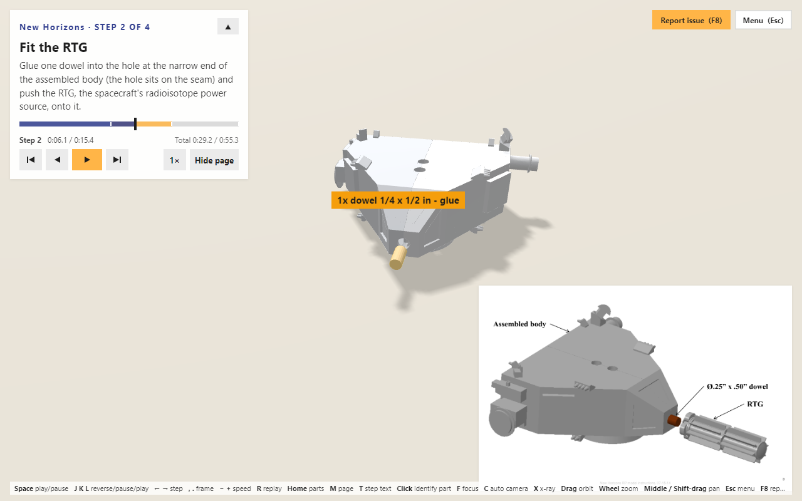
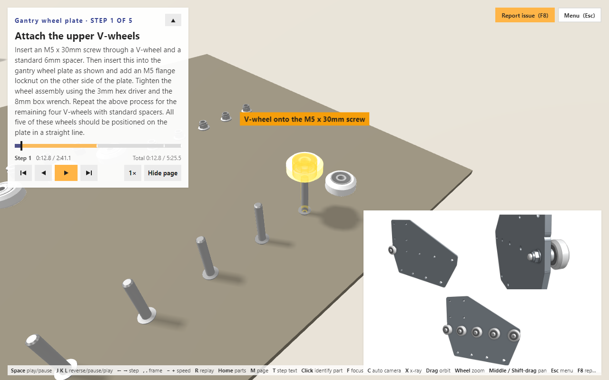
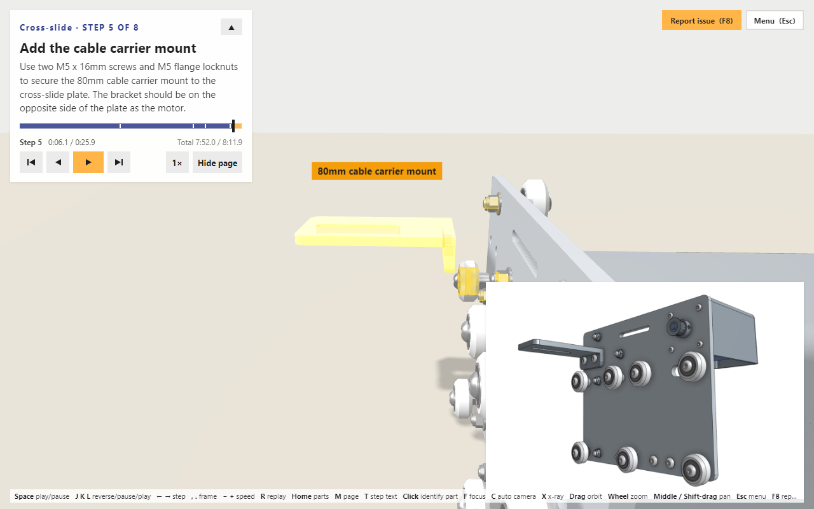
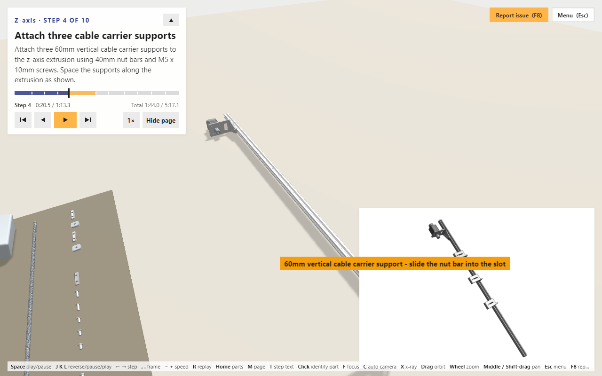

# Open Assembly Lab

**Public-domain kits as 3D assembly instructions you can build with your hands in VR - in the browser, nothing to install.**

**Live: https://hybrisen777.github.io/open-assembly-lab/**

Printed instructions show a few frozen moments; this shows the whole motion. Every step is animated from the loose
parts to the finished model, next to the original instruction page - and in VR you do the steps yourself, with your
hands, on a table in front of you.

Everything shown here comes from sources that are free to reuse: NASA's 3D-printable models of the New Horizons and
SOHO spacecraft, and three sub-assemblies of the FarmBot Genesis v1.5 machine - each with its own assembly instructions
from the same source.

## Try it

| Device | How |
|---|---|
| **Meta Quest** | Open the link in the **Quest Browser**, pick the kit, press **Enter VR**. Hands or controllers. |
| **Phone with AR support** | **Enter AR**: the kit stands on your real table or floor. |
| **Desktop / laptop / any phone** | Any current browser: 3D player with mouse, touch and keyboard. |

## In VR - built for hands

- **Hands first.** Point and pinch to press buttons; pinch a glowing part, bring it to its blue outline - it clicks in
  by itself. No controller needed from start to finish (controllers work too).
- **Seated or standing, no walking.** The kit comes to a table in front of you, every part within reach. Pinch with
  both hands in empty space and pull apart to make it bigger, move or turn it.
- **Forgiving like real assembly.** Identical parts are interchangeable (any dowel in any hole).
- **Watch or build.** *Just watch* plays the animation; *Build it yourself* waits for you at every move.
- **The instructions stay with you.** The original page is on the panel; tap it for a large, sharp copy.

## What's inside

**New Horizons spacecraft model** - 4 steps, 9 parts: the body printed in two halves, the RTG and the antenna (NASA's
STL files, unchanged), joined with five 1/4 x 1/2 inch dowels from a hardware store. The finished model is about
17 x 14 x 11 cm; the player shows it at real size.

**SOHO spacecraft model** - 4 steps, 7 parts: the solar panel part with the antenna dish, the lower body and the
upper body (the kit's three STL files, unchanged), joined with four 10 mm pins cut from spare 1.75 mm printer filament.
The finished model is about 17.5 cm across the solar panels and 6.6 cm tall. Its instructions are a plain text file;
the page beside each step shows that text word for word, with the lines of the current step in black. The text
presses the two body parts together first; here that step comes last, so that every part is added from above.

**FarmBot Genesis v1.5: gantry wheel plate** - 5 steps, 43 parts: one plate, 9 V-wheels, 9 M5 x 30mm screws, 5 standard
and 4 eccentric spacers, 9 flange locknuts, 2 nut bars and 4 M5 x 10mm screws - every screw, spacer and nut is its own
part, taken from the machine's CAD model at its CAD position. Steps, their order, their text and the pictures beside
them are the documentation's own. As the documentation says, a wheel and a spacer go onto a screw first and the stack
then goes into the plate; the locknuts are fitted from the other side of the plate.

Not shown in this assembly, because the player cannot represent it:
- the tools (3mm hex driver, 8mm box wrench, mallet) and the tightening itself - screws and nuts are only put in place;
- step 4, the same build repeated for the mirrored right-hand plate - the step is there with its text and picture, but
  only the left-hand plate is built;
- step 5, adjusting the eccentric spacers - the step is there with its text, nothing moves in it.

Also different from a real workbench: a screw stands on its head on the mat while its wheel and spacer are slid on
(a person would hold it), and the plate stands upright by itself.

**FarmBot Genesis v1.5: cross-slide** - 8 steps, 68 parts: the plate with its twelve V-wheels (seven for the gantry
beam on one side, five for the Z-axis on the other), the leadscrew block, the stepper motor in its housing with the
pulley, and the cable carrier mount; again every screw, spacer, nut and setscrew is its own part at its CAD position.
Steps 1-5 are built part by part. At step 2 the half-built cross-slide is turned over, as the documentation says, and
the motor goes into its housing before both go onto the plate.

Not shown in this assembly, because the player cannot represent it:
- step 6, adjusting the eccentric spacers - text only, nothing moves;
- step 7, sliding the cross-slide onto the gantry main beam - text and picture only: the beam belongs to the gantry,
  which is already standing at that point, and the player can only lower an assembly straight down onto parts laid out
  beforehand, not slide it along a rail;
- step 8, the timing belt with its two belt clips, nut bars and screws on the beam - text and pictures only;
- the tools (3mm hex driver, 8mm box wrench, 2mm driver) and all tightening.

Where the CAD model and the documentation differ, the parts follow the CAD and the text follows the documentation:
the text names M3 x 12mm motor screws, the CAD has M3 x 10mm; the pictures show the leadscrew block's screw heads on
the gantry side, the CAD has them on the block; the CAD's cable carrier spacer block is in no step of this page and is
left out. One photograph of step 7 is not shown because the motor label in it carries the company's wordmark.

**FarmBot Genesis v1.5: Z-axis** - 10 steps, 54 parts: the one-metre extrusion with its motor and mount, shaft coupling,
four cable carrier supports, vacuum pump with cover and mount, hardstops and motor housing - nut bars, tee nuts and
every screw as their own parts at their CAD positions. Steps 1-7 are built lying on the bench: brackets get their screws
and nut bar loosely first and are then slid into the extrusion's slot from its free end, the only way a nut bar goes in.
In step 8 the Z-axis is stood up and lowered through the V-wheels of the finished cross-slide onto the leadscrew, and
steps 9-10 add the hardstops and the motor housing upright.

Not shown in this assembly, because the player cannot represent it:
- the two zip ties that hold the vacuum pump on its mount (step 6);
- the gantry: in step 8 the finished cross-slide, which is one part here, hangs in the air where the gantry main beam
  would hold it;
- adjusting the eccentric spacers and tightening the coupling's screws (steps 3 and 8) - the coupling's lower screws are
  put in at step 3 with the upper ones;
- the tools (2.5mm hex key, 3mm hex driver) and all tightening.

Changed for the browser: the leadscrew's thread is modelled in the CAD with 463,000 triangles and is shown with 4 % of
them; the cross-slide unit comes from a coarser export. Everything else is the CAD's own mesh. As with the cross-slide,
the text names M3 x 12mm motor screws where the CAD has M3 x 10mm.

More assemblies can be added the same way: part meshes + step-by-step instructions in, a scenario out.

## How it's made

- **Parts** are the kit's own meshes, one object per physical part. For the printable kits their assembled positions
  are worked out from the pins and holes in the meshes; for the machine sub-assembly they come from the CAD assembly.
- **Assembly motion** is planned and collision-checked in a game engine (mesh against mesh along every part's path),
  then exported as engine-independent data - step timelines and poses - that this site plays with WebGL.
  A static site: no framework, no build step in the browser.
- **VR / AR** is plain [WebXR](https://immersiveweb.dev): hand tracking, world-space panels, grab-and-snap logic.
- **Checks**: `tools/smoke_test.js` plays every kit to the end with the mouse, then starts a hands-only VR session on
  an emulated headset and places every part of every kit with emulated tracked hands (9 of 9, 7 of 7, 43 of 43, 68 of 68
  and 54 of 54).

## Known limitations

- The models are small and shown at real size: the New Horizons dowels are 6 mm thick, the SOHO pins 1.75 mm.
  In VR, pull the kit bigger with both hands. The gantry wheel plate has M5 hardware: nuts and spacers of about 1 cm.
- Z-axis: the kit is a metre long, so VR Table mode shows it at about half size (0.47) - an M5 screw head then looks
  4 mm wide. Pull the kit bigger with both hands.
- The hands-only check closes the emulated fingers on the part before pinching. Aimed with an open hand and snapped
  shut, the emulator's pinch point jumps 77 mm and misses thin large parts (the Z-axis extrusion, the leadscrew, the pump
  mount on edge), which can be picked up only within 4 cm.
- Gantry wheel plate: the locknuts and the nut-bar screws are fitted on the far side of the plate; the camera turns
  there by itself on the desktop, in VR you reach around the plate. The hands-only check uses an emulated headset; it
  shows that every part can be picked up and placed by pinching, not how comfortable that is with real hands.
- Phone browsers without WebXR: the 3D player works, the VR / AR buttons don't appear.
- Headset linked to a PC (Quest Link): the first VR start can take 2-3 minutes.

## Sources and credits

**Gantry wheel plate**, **cross-slide** and **Z-axis** - from the FarmBot Genesis v1.5 documentation
([Assemble the gantry wheel plates](https://genesis.farm.bot/v1.5/FarmBot-Genesis-V1.5/gantry/assemble-the-gantry-wheel-plates),
[Cross-slide](https://genesis.farm.bot/v1.5/FarmBot-Genesis-V1.5/cross-slide),
[Z-axis](https://genesis.farm.bot/v1.5/FarmBot-Genesis-V1.5/z-axis): steps, text and pictures) and the
FarmBot Genesis CAD model on Onshape
([document, version v1.5](https://cad.onshape.com/documents/6626b842adca229e69544ad1/v/d2f8602693fe1c17dfeb2b8b/e/33c3dd58328095f9e1e1dcee):
the "Gantry Wheel Plate" assembly, left-hand configuration, the "Cross-Slide" and "Z-Axis" assemblies, and the whole
machine for the position of the cross-slide on the Z-axis; exported as GLB). Both are by FarmBot Inc. and, according
to its [licensing page](https://meta.farm.bot/v2026/farmbot/intro/licensing) (read on 18 November 2026), published
under the CC0 Public Domain Dedication:
> "The FarmBot CAD models are licensed under the CC0 Public Domain Dedication." -
> "FarmBot documentation is licensed under the CC0 Public Domain Dedication."

The company's logo and other brand material are not CC0 and are not used here.
**This project is not affiliated with or endorsed by FarmBot Inc.**

The two spacecraft kits come from the NASA 3D Resources repository, folder `3D Printing`:

- **New Horizons** - model files (`7399_05_rp_*.stl`) and assembly instructions (`assembly.pdf`, "New Horizons RP model
  instructions", 07-15-14):
  [3D Printing/New Horizons](https://github.com/nasa/NASA-3D-Resources/tree/master/3D%20Printing/New%20Horizons).
  The instruction pages are shown without their header bar.
- **SOHO** - model files (`Part 1.stl`, `Part 2.stl`, `Part 3.stl`) and assembly text (`readme.txt`):
  [3D Printing/Solar and Heliospheric Observatory (SOHO)](https://github.com/nasa/NASA-3D-Resources/tree/master/3D%20Printing/Solar%20and%20Heliospheric%20Observatory%20(SOHO)).

Reuse statements for the NASA source, quoted as published (read on 18 November 2026):

- The repository's [README](https://github.com/nasa/NASA-3D-Resources/blob/master/README.md), which covers both kits:
  > "This is a growing collection of 3D models, textures, and images from inside NASA. [...] These assets are free and
  > without copyright."
- The usage guidelines that README points to,
  [NASA Images and Media Usage Guidelines](https://www.nasa.gov/nasa-brand-center/images-and-media/):
  > "NASA content - images, audio, video, and media files used in the rendition of 3-dimensional models, such as
  > texture maps and polygon data in any format - generally are not subject to copyright in the United States. You may
  > use this material for educational or informational purposes, including photo collections, textbooks, public
  > exhibits, computer graphical simulations and Internet Web pages."

  > "NASA content used in a factual manner that does not imply endorsement may be used without needing explicit
  > permission."

No agency or mission emblem is shown anywhere on this site. **This project is not affiliated with or endorsed by NASA.**

- Controller and hand models: WebXR Input Profiles (MIT). 3D rendering library: three.js 0.169 (MIT).
- A non-commercial research demo by Jeremi Ranosz, Poznań University of Economics and Business (UEP), Department of
  Information Technology (KTI).

## This repository

The repository root is the built site (generated by the assembly pipeline's site build - changes to those files are
replaced by the next build). `tools/smoke_test.js` checks a build and renews the pictures in `media/`.
